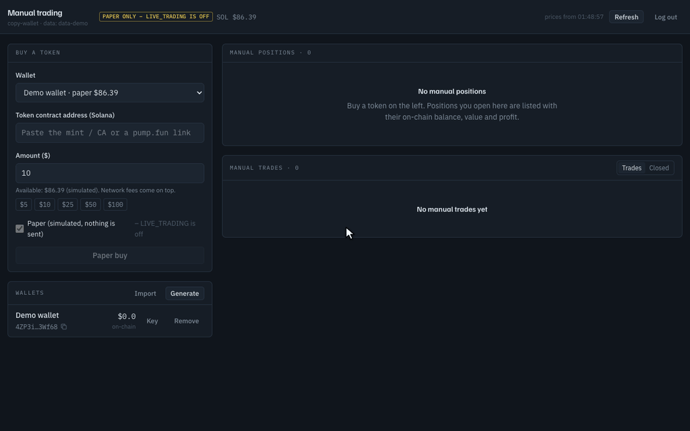

# copy-wallet

**Solana only.** It reads Solana transactions and trades Solana tokens. It does not work on Ethereum, Base, BSC or any other chain.

copy-wallet is a self-hosted copy-trading bot. It watches the Solana wallets you pick and copies their token trades from your own wallets, scaled to your size.

The repo also has a **manual buy/sell tool** in [`manual/`](manual/README.md). Paste a token address or a pump.fun link and see how much of the supply your dollar amount buys. Then buy, and sell by hand or with a sell plan that sells slowly as the market cap reaches your levels. It has its own wallets and login. Start it with `bash manual/run.sh` (after `pnpm install`) and open http://127.0.0.1:8790.



## What the bot does

- **They buy:** you buy a set share of what they spent (10% by default), within your limits.
- **They sell part of a position:** you sell the same part of yours. A near-total exit counts as 100%.
- It works with any app or DEX (fomo, pump.fun, PumpSwap, Jupiter, Raydium, Meteora, …), because it reads balance changes on-chain. It has no connection to fomo or its usernames.
- New traders start in **paper mode**: trades are simulated at real prices and nothing is sent.
- A local web page shows live trades, open positions, profit and entry/exit market caps, with buttons to close positions.

## Quick start

```bash
pnpm install
cp .env.example .env    # add HELIUS_API_KEY and JUPITER_API_KEY
pnpm dev
```

Open http://127.0.0.1:5173, choose a passphrase, then go to **Traders → Copy a new trader**.

You need two keys:

- **Helius** (https://dashboard.helius.dev) to watch wallets and send transactions. The free plan works.
- **Jupiter** (https://portal.jup.ag) for swaps, prices and token info. The free key is enough to start.

While developing:

- The server restarts when you save code or `.env`.
- Logs go to the terminal, to `data/logs/` (5 files of 10 MB) and to the **Logs** page. `LOG_LEVEL=debug` in `.env` shows how each transaction is parsed.
- `pnpm dev:debug` starts the server with `--inspect`, so you can set breakpoints in VS Code or Chrome DevTools.
- Everything is stored in SQLite at `data/copy-wallet.db`: detected trades, every copy (done, skipped or failed, with the reason), positions and profit.
- `.env` holds keys and infrastructure and needs a restart. Trading settings live on the **Settings** page and in each trader's settings, and apply right away.

## Running it unattended (Docker)

The same code, `.env` and `data/` folder run in a container that restarts by itself:

```bash
docker compose up -d --build   # start in the background
docker compose logs -f bot     # follow the logs (Ctrl+C stops following, not the bot)
docker compose up -d           # apply .env changes (a plain restart doesn't reload .env)
docker compose down            # stop
```

The page is at http://127.0.0.1:8787.

- Only one copy of the bot can use `data/`. If `pnpm dev` is running, the container refuses to start, and the other way round, so no trade is copied twice.
- On a laptop, keep it awake (macOS: `caffeinate -dims`). Sleep, a closed lid or lost Wi-Fi stops the bot.
- After a crash or reboot the wallet keys stay locked until you log in. To unlock automatically, set `KEYSTORE_PASSPHRASE` in `.env` (in single quotes if it contains `#`). Anyone who can read `.env` can then use your trading wallets.

## Running it on a server

[deploy/SERVER-SETUP.md](deploy/SERVER-SETUP.md) is a one-time setup: a small Hetzner server that is reachable only through a private [Tailscale](https://tailscale.com) network, plus automatic deploys from GitHub.

- Pull requests and branch pushes run the tests and a Docker build. A merge to `main` deploys, once the repository variable `DEPLOY_ENABLED` is `true`.
- A deploy builds the new version while the old one keeps trading. It switches over once copies in progress finish, and rolls back by itself if the new version isn't healthy. Telegram reports the result.
- `pnpm server:status`, `server:logs [2h]`, `server:follow`, `server:db "select …"`, `server:deploys`, `server:backup`, `server:restart`, `server:reload` and `server:ssh` check the server from your laptop ([scripts/server.sh](scripts/server.sh)).
- `GET /api/health` (no login) shows the running version, the stream connection and whether the keys are unlocked.
- After a restart, the bot looks at each watched wallet's latest transactions and copies trades it missed that are still recent enough (**Settings → Ignore signals older than**, 20 s by default).

## Wallets and keys

- **Generate wallets in the app** (recommended). Each trader group gets its own wallet. The key is created on this machine and never goes through your clipboard. **Export key** shows it after you enter your passphrase, for example to open the wallet in Phantom.
- **Import** works for an existing wallet that you use only for this. Paste keys only into the app's own page, never into a chat or AI tool, and never use your main wallet.
- Keys are encrypted with AES-256-GCM using a key derived from your passphrase (scrypt), and stored in `data/copy-wallet.db`. After you log in they're kept decrypted in memory, so trades are signed automatically.
- There is no passphrase reset. Back up `data/`.
- Fund the wallets yourself (**My wallets → Fund** shows the address and a QR code), and only with what you can afford to lose.

## How copying works

### Trader groups

A group is a trader's main wallet plus their side and bundler wallets, all copied into one of your wallets. Each watched wallet's trades are tracked on their own. When a bundler sells, you sell only the part of your position that the bundler's buy opened, so you exit when the wallet that got you in exits.

### Sizing

Set per group, for all its wallets, including side wallets you add later.

- **% of their trade size** (default, 10%): they buy $100, you buy $10; they add $50, you add $5. Your position has their shape, just smaller.
  - Copies below the minimum ($3) are raised to it, because smaller buys lose too much to fees.
  - One buy uses at most *max % of your balance* (25%). If they buy $1,000 (10% would be $100) and you have $60, you buy $15. That leaves room for their adds.
  - Adds stop at *max per token* ($50).
  - The trader's portfolio size doesn't matter, so whales who bet small are copied too.
- **% of their cash:** what they spent divided by their SOL + USDC + USDT + USD1, applied to your balance.
- Sells work the same in both modes: they sell 50% of their tokens, you sell 50% of yours.
- You always pay in SOL, so fund your wallets with SOL.

### What isn't copied

- trades older than **Settings → Ignore signals older than** (20 s by default), for example after a reconnect
- tokens with a freeze authority, tokens that can still be minted, and Token-2022 tokens with risky features (transfer fees or hooks, permanent delegate, pausable)
- dev launches, where the trader creates a token and buys it in the same transaction (can be turned on in Settings)
- adding or removing liquidity, staking and locking, which would otherwise look like sells
- buys from a group whose "copy new buys" is off (its sells are still copied)
- swaps from SOL into stablecoins, staked SOL (jitoSOL, mSOL, …) or wrapped BTC/ETH, which are cashing out, not buys

### Transfers and withdrawals

- A buy only counts when the trader's transaction went through a DEX or launchpad. SOL sent to an exchange, tokens sent to another wallet, bridging out and tokens arriving from a bridge never open a position.
- Tokens sent out of a watched wallet count as a sell of that share, whatever the destination: a 50% transfer sells 50% of the position copied from that wallet, a full transfer exits it. The pause switch and the "copy sells" setting still apply.
- A sell is copied even if the trader withdraws the SOL in the same transaction.
- Trades paid in SOL, USDC, USDT or USD1 are recognized. Some pump.fun pools trade against other tokens: add those under **Settings → Extra quote tokens**.

### Selling, failures and safety

- A failed sell is retried with wider slippage (auto, then 25%, 40%, 60%), but only after a definite failure. If the result is unknown, for example after a timeout, the bot keeps checking the original transaction and never sends a second sell.
- **Pause all trading** stops every buy and sell. You can still close positions by hand.
- Jupiter builds its transactions on its own server, so each one is simulated before signing. It's refused if it would take more SOL than the trade plus 0.02 SOL. Direct pump.fun trades are built by the bot itself.
- Market cap = fill price × total supply. Each trade shows your market cap next to the trader's, so you can see what the copy delay costs.

### Crashes and parallel buys

- Before a live swap is sent, its signature and details are saved. A confirmed fill and its position update are saved together.
- At startup, unfinished swaps are checked before anything else. Unknown results are rechecked every 10 seconds using the original signature, never sent again. While a buy is unresolved, that wallet spends nothing more. While a sell is unresolved, that token isn't traded.
- Swaps that were interrupted before sending are marked failed.
- Several buys at once each reserve their cash, fees and position slot first, then run in parallel.
- All RPC calls share Helius's rate limit (10 requests a second on the free plan), and trade requests go first.

## Direct pump.fun trades

For pump.fun and PumpSwap trades the bot skips Jupiter. The trader's own transaction already shows which program they used, so this needs no extra lookup.

1. One RPC request reads the token's bonding curve, or its PumpSwap pool once it has graduated, along with a fresh blockhash.
2. The transaction is built with pump.fun's official SDK and signed on your machine. On the curve it spends exactly your copy size (`buy_exact_sol_in`) for at least a minimum number of tokens.
3. It's sent through [Helius Sender](https://www.helius.dev/docs/sending-transactions/sender), which uses no credits. You pay a small tip instead.
4. The exact amounts are read back from the confirmed transaction.

Compared with Jupiter there's one less round trip, no 1-request-a-second queue when several bundlers buy at once, and no Jupiter fee (0.5% on tokens under 24 h old).

**Cost per trade** (Settings → *Fast pump.fun trading*): by default a 0.0002 SOL priority fee, a 0.00001 SOL tip and the network fee, about 0.000215 SOL. The *Max* sending route also goes through Jito and lands fastest, with a minimum tip of 0.001 SOL.

The bot uses Jupiter instead, before sending anything, for tokens not on pump.fun, curves priced in PUMP or USDC, and non-standard pools. A direct transaction that was already sent is never re-sent through Jupiter. Paper mode prices pump.fun trades with the same curve and pool math, so paper results match live ones.

After updating the `@pump-fun/*` packages, run `pnpm -F server verify:pump`. It builds real buys and sells for recent pump.fun and PumpSwap traders and simulates them on mainnet without sending anything.

## Telegram alerts

Set `TELEGRAM_BOT_TOKEN` and `TELEGRAM_CHAT_ID` in `.env`. **Settings → Telegram** has on/off switches and a test button. You get:

- **each copied buy or sell:** the trader and wallet, the token, paper or live, your amount and market cap next to theirs, the speed (seen, sent, landed) and route, fees, your position and balance after, and profit on sells
- **failed copies** with the error, and **skipped copies** with the reason
- **problems:** errors (the same one at most every 10 minutes), trader transactions that couldn't be read, Helius disconnected for over a minute (and back), keys locked while live trading is on, transactions with an unknown result, and the bot starting or stopping

The manual tool sends no Telegram messages.

## Helius plans and costs

Helius pushes a message the moment a watched wallet transacts, so the bot never polls for trades.

| | Free (`HELIUS_TIER=free`) | Developer, $49/mo (`HELIUS_TIER=developer`) |
|---|---|---|
| Stream | `logsSubscribe` per wallet (signature and logs) | `transactionSubscribe` (one subscription, full transaction) |
| Extra step | `getTransaction` once confirmed (+0.5 to 1.5 s) | none |
| Typical delay, their trade to your fill | 2 to 3.5 s | 1 to 2 s |
| Rate limit | 10 requests/s (bundler bursts can queue) | 50 requests/s |
| Credits (10 wallets × 200 tx/day, 50 copies/day) | about 130k of 1M | about 40k of 10M |

Start on Free for watching and paper trading, and switch to Developer (one line in `.env`) when real SOL is in. The header shows the credits used this billing cycle.

**On-chain cost per copy**, on top of Helius:

- network fee, priority fee and tip: about 0.0005 to 0.002 SOL
- Jupiter fee: 0.1%, or 0.5% for tokens under 24 h old
- the pool's own fee
- the first buy of a token: about 0.002 SOL account rent, returned after a full exit

**Other requests** only happen when needed:

| | When |
|---|---|
| Your wallet balance | Right before each live buy, and when you open **My wallets** or press **Refresh** |
| Trader's stablecoin balances | Only in "% of their cash" mode: once per copied buy, cached 30 s |
| Prices of your positions | When you open **Dashboard**, **Positions** or a wallet's page, or press **Refresh** |
| SOL/USD price | With those pages, or after a fill, at most every 2 minutes |
| Token names and logos | When a page shows a token without a name |
| pump.fun config | At start, then cached 10 minutes, only when trading directly |

The page has no timers. It loads when you open it, reloads on **Refresh**, and updates when the bot pushes a change (a trade, a signal, a reconnect).

## Before trading real SOL

1. Run paper mode for a day or more. Check that the copies and their market caps on **Trades** and **Positions** make sense.
2. Generate a fresh wallet, fund it with a small amount (for example 0.2 SOL) and set a small **Max per trade**.
3. Set `LIVE_TRADING=true` in `.env` and restart. Live trades are impossible while it's `false`.
4. Do a tiny live buy (**My wallets → Buy a token**), then **Positions → Close**. Check both on Solscan, and that **Reclaim rent** works.
5. Switch one trader group to live (its **Mode** setting on **Traders**). Optionally set a **Daily loss limit**.

## Tests

```bash
pnpm test                    # parser (real mainnet transactions and edge cases), sizing, lot accounting, engine
pnpm typecheck
pnpm -F server fixtures      # refresh the real-transaction fixtures from mainnet
pnpm -F server verify:pump   # simulate direct pump.fun/PumpSwap buys and sells on mainnet (sends nothing)
```

## Troubleshooting

- **"Another copy of the bot is already running":** stop the other one (`pnpm dev` or `docker compose down`).
- **Wallet keys locked:** log in, or click **locked** in the header.
- **Live groups are skipped with "live trading is off":** set `LIVE_TRADING=true` in `.env`.
- **The container can't write `data/`:** with Colima, mount your home folder writable (`colima start --edit`, then `mounts`). On Linux, run `sudo chown -R 1000:1000 data`.
- **`bigint: Failed to load bindings` at startup:** harmless, a pure-JS fallback is used.

## Layout

```
server/src
  stream/     wallet monitoring (free: logsSubscribe and lookup, developer: transactionSubscribe), reconnects, backfill
  parser/     works out buys and sells and their % from balance changes, for any DEX
  engine/     guards, sizing, execution, lots and profit, manual trades, startup reconciliation
  executor/   direct pump.fun/PumpSwap (SDK and Helius Sender) or Jupiter Swap API v2, paper fills
  solana/     RPC with rate limiting and credit tracking, Jupiter, token info, balances, rent reclaim
  keystore/   encrypted wallet keys
  api/        REST and live WebSocket for the page
web/src       React page (Dashboard, Positions, Traders, My wallets, Trades, Logs, Settings)
manual/       the manual buy/sell tool (see manual/README.md), never deployed
deploy/       server setup, deploy with rollback, backups, container entrypoint
scripts/      server.sh, helpers to check the production server
.github/      CI (branches and pull requests) and deploy (main)
data/         database, encrypted keys and logs (git-ignored, back it up)
```
